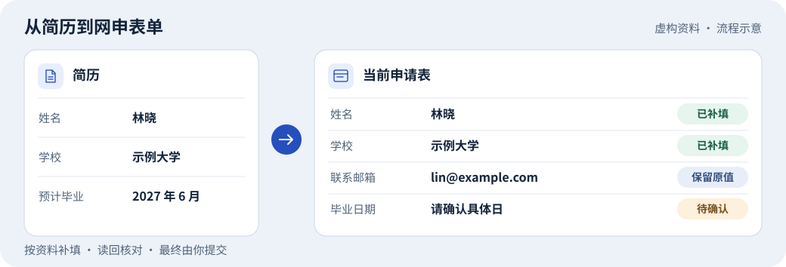

<h1 align="center">Apply with Browser</h1>

<strong>打开网申页，给一份简历，让 AI 帮你补齐空白项。</strong>

  一个适用于招聘、实习、校招、在线简历和院校申请的 Agent Skill。 
  保留你已填的内容，填写后逐项核对，最后由你决定是否提交。

  <a href="https://github.com/Ruoyu-Tianyi/apply-with-browser/releases/latest/download/apply-with-browser-workbuddy.zip"><strong>下载 WorkBuddy 版</strong></a>
  &nbsp;·&nbsp;
  <a href="https://github.com/Ruoyu-Tianyi/apply-with-browser/releases/latest/download/apply-with-browser-standard.zip"><strong>下载通用版</strong></a>
  &nbsp;·&nbsp;
  <a href="https://github.com/Ruoyu-Tianyi/apply-with-browser/releases">查看发布记录</a>

## 第一次使用

1. **安装 Skill。** WorkBuddy 下载专用版，其他客户端使用通用版。安装位置见[下方表格](#安装与连接)。
2. **打开表单。** 在 Agent 已连接的浏览器里打开目标网申或在线简历，登录后停在填写页。
3. **提供简历并发一句话。** 附上文件、给出 Agent 可读取的路径，或直接粘贴相关内容。

> 用 apply-with-browser 帮我填写当前页。以这份简历为准，先补空白项，填完告诉我还缺什么。最终由我提交。

页面和资料已经明确时，Agent 会直接开始。遇到必须由你确认的项目，它会集中列出，比如实习起止日、期望城市或材料中没有写明的成绩。

## 能帮你做什么

| 场景 | 处理方式 |
| --- | --- |
| 重复填联系方式、学校和实习经历 | 按简历匹配当前表单的字段，保留已有内容，填写后读回核对。 |
| 日期、学历和下拉选项 | 按页面的实际选项匹配。资料只有毕业月份、表单却要求精确到日时，留给你确认。 |
| 自我介绍或职业规划 | 按题目和字数要求，用已有经历起草可核对的文本。 |
| 简历、成绩单和暂存 | 按你的要求上传指定文件或暂存，核对页面的文件名和保存结果。 |
| 浏览器只能读页或尚未连接 | 整理可直接粘贴的内容，并说明接下来需要你完成哪一步。 |

> [!NOTE]
> Skill 提供填写和核对流程。点击、输入、上传和保存由当前客户端的浏览器工具执行，取决于会话能力和网站控件。

## 安装与连接

| 客户端 | 安装方式 | 浏览器接入 |
| --- | --- | --- |
| **WorkBuddy** | 「技能 → 添加技能 → 上传技能」，选择 WorkBuddy 版 ZIP | 在「设置 → 智能体 → 浏览器操控」连接目标浏览器 |
| **OpenClaw** | 解压通用版，放入目标 Agent 的 `<workspace>/skills/`，用 `openclaw skills list` 确认 | 使用当前 Agent 的 `browser` 工具和对应浏览器配置 |
| **Codex** | 解压通用版，放入项目的 `.agents/skills/`。在本仓库内也可按 `AGENTS.md` 使用 | 使用当前会话已连接的浏览器工具 |
| **Claude Code** | 解压通用版，放入项目的 `.claude/skills/` | 使用当前会话可用的浏览器工具 |
| **Cursor** | 解压通用版，放入项目的 `.cursor/skills/` 或 `.agents/skills/` | 使用当前会话可用的浏览器工具 |

解压时请保留完整的 `apply-with-browser/` 目录，包括 `SKILL.md` 和 `references/`。平台连接和权限设置见[运行环境适配](skills/apply-with-browser/references/runtime.md)。

## 可以直接说

| 想做什么 | 在对话里补一句 |
| --- | --- |
| 只填文字 | “只补当前页空白文字框，保留行业和下拉选项。” |
| 上传指定文件并暂存 | “把这份 PDF 放到简历附件栏，核对文件名后点暂存。” |
| 先准备文案 | “根据简历和这个岗位的要求，写一段可直接粘贴的自我介绍。” |
| 接着上次填 | “继续上一张表，先核对页面和已经填过的字段。” |

## 常见问题

**安装了 Skill，但 Agent 找不到我打开的网页？**

先确认 Agent 连接的是你正在用的浏览器和标签页，再按对应客户端的[连接说明](skills/apply-with-browser/references/runtime.md)检查。若只能读取页面，可先请它整理待填文本。

**为什么某些日期或附件仍然留空？**

日期按资料中明确的精度填写。附件需能被浏览器所在的设备或服务读取，也需要客户端支持上传。Agent 会说明哪一项待确认或需要手动处理。

**暂存等于投递了吗？**

暂存只保存草稿。Agent 根据页面提示核验保存结果，最终提交由你决定。

## 源码与贡献

[SKILL.md](skills/apply-with-browser/SKILL.md) 定义工作流程，[`references/`](skills/apply-with-browser/references/) 保存日期、学历、陈述、控件和客户端接入规则。

在仓库根目录运行 `python scripts/package_skill.py`，可在 `.local/skill-packages/` 生成两个 ZIP。分发包包含通用指令、参考资料和许可证。

可用[测试表单](tests/fixture.html)和虚构资料检查空白项填充、已填值保留及中断恢复。提交 [Issue](https://github.com/Ruoyu-Tianyi/apply-with-browser/issues/new) 时，请附上客户端、字段类型和脱敏后的复现步骤。

[MIT License](LICENSE)
